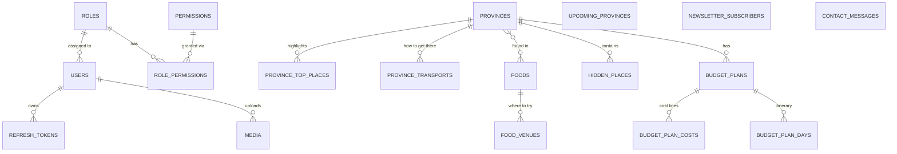

# Database Design

The API backs the **TvOrt** travel guide (Next.js frontend, `tv_ort_v2`). Auth (users, roles, permissions, refresh tokens) is unchanged from the original inventory project; the content tables were rebuilt from the frontend's former hard-coded data (`lib/data/*.ts`).

PostgreSQL + Prisma. Schema: `prisma/schema.prisma`. Seed: `prisma/seed.ts` + `prisma/seed-data/content.json`.

## Entity Relationship Diagram

## Conventions

- **Localized text.** Columns marked _localized_ are `Json` holding `{ "en": "...", "kh": "..." }` (`kh` optional). This is the frontend's `Text` type, so `tx(value, locale)` works on API responses unchanged. Validated on write by `LocalizedTextDto`.
- **Slugs.** `provinces`, `foods`, `hidden_places`, `budget_plans` are addressed by unique `slug` in URLs and in cross-references (`"province": "kampot"`).
- **`sortOrder`.** Display order, lowest first. Child rows get their order from array position on write.
- **Money.** `Decimal(10,2)` USD, returned to clients as plain JSON numbers.
- **Enums** (`Interest`, `FoodType`, `PlaceCategory`, `CostCategory`) are lowercase on purpose: they are the keys the frontend uses for its type unions and label lookups.
- **Images** are plain strings (Unsplash photo id, URL or uploaded path); the frontend's image loader decides how to render them.
- Child collections are **replaced wholesale** when sent on update (`topPlaces`, `gettingThere`, `whereToTry`, `provinces`, `costs`, `outline`, `tips`, `images`).

## Auth tables (unchanged)

`users`, `roles`, `permissions`, `role_permissions`, `refresh_tokens`, plus `media` (file uploads). See the original RBAC design in `.kiro/specs/role-permission-rbac/`.

Roles: **Admin** (everything), **Support** (edit content, upload media, handle visitor messages), **Customer** (default for self-registration; no admin access).

## Content tables

### provinces
`slug` UK · `name`, `tagline`, `whyGo`, `bestSeasonMonths`, `bestSeasonDetail`, `goodToKnow?`, `budgetNote` (_localized_) · `image` · `interests Interest[]` · `budgetStay/Food/Transport/Activities` (USD per person per day) · `sortOrder`

### province_top_places · province_transports
Ordered children of a province (cascade delete). Top places: `name`, `description`, `image`. Transports ("How to get there"): `mode`, `detail`.

### upcoming_provinces
"Coming soon" teasers: `name`, `image`, `interests[]`. Separate from `provinces` because they carry none of the page content. To launch one, create the province and delete the teaser.

### foods · food_venues · `_FoodToProvince`
`slug` UK · `name`, `summary`, `whatItIs`, `priceUnit` (_localized_) · `khmerName`, `pronunciation` · `type FoodType` · `priceMin/priceMax` · `image` · `sortOrder`.
`food_venues` = "where to try it" rows. `_FoodToProvince` is Prisma's implicit many-to-many join (cascade on both sides).

### hidden_places
`slug` UK · `provinceId` FK (RESTRICT) · `category PlaceCategory` · `name`, `summary`, `special`, `howToReach`, `costNote`, `bestTime` (_localized_) · `khmerName?` · `images String[]` (first = cover) · `costMin/costMax` · `sortOrder`

### budget_plans · budget_plan_costs · budget_plan_days
`budget_plans`: `slug` UK, `provinceId` FK (RESTRICT), `title`, `summary` (_localized_), `tips` (JSON array of localized), `days`, `people`, `image`, `sortOrder`.
`budget_plan_costs`: one line per cost (`category CostCategory`, `label`, `amount`). Totals are **computed** by the API (`total`, `categoryTotals`), never stored.
`budget_plan_days`: one itinerary day (`title`, `items` = JSON array of localized). Day number = position by `sortOrder`.

## Visitor submissions

| Table | Written by | Notes |
|---|---|---|
| `newsletter_subscribers` | `POST /newsletter/subscribe` | `email` unique, stored lowercase; re-subscribing is a no-op |
| `contact_messages` | `POST /contact-messages` | `readAt` null = unread |

## Deleting a province

`hidden_places.provinceId` and `budget_plans.provinceId` are `RESTRICT`: the API answers **409** until those rows are moved or deleted. A province's top places, transports and food links cascade.

## Derived, not stored

Province `planSlug` (its first plan by `sortOrder`), `sampleBudget.total`, plan `total` / `categoryTotals`, food `related` (same-province foods) and place `related` (same-province places).
